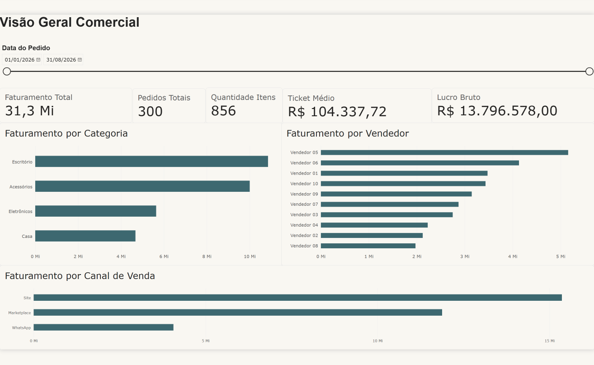
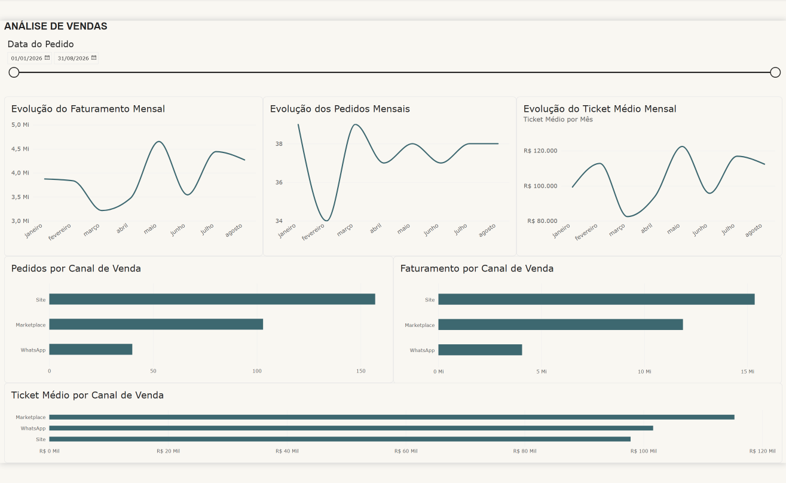
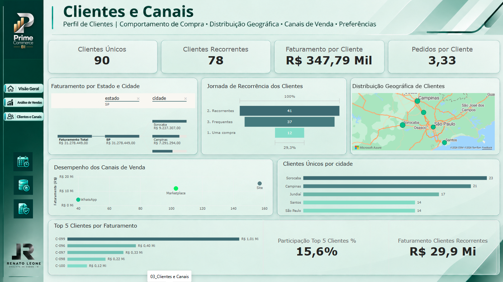

# 📊 PrimeCommerce BI — Análise Comercial e Dashboard de Vendas

**Projeto de Business Intelligence desenvolvido por Renato Leone**

Projeto de portfólio que transforma dados operacionais de um e-commerce em indicadores, análises visuais e insights para apoiar a tomada de decisões comerciais.

## 🎯 Problema de negócio

A gestão da PrimeCommerce precisa acompanhar o desempenho comercial e entender como o faturamento se distribui entre canais de venda, categorias de produtos e vendedores.

O objetivo é transformar dados operacionais de um e-commerce de pequeno porte em indicadores e análises visuais que apoiem o acompanhamento do desempenho comercial e a tomada de decisões.

## 🗂️ Sobre os dados

- **Fonte:** dados simulados para fins de estudo e portfólio
- **Segmento:** e-commerce
- **Período:** janeiro a agosto de 2026
- **Registros:** 1.492, conforme a documentação da base de origem
- **Formato:** CSV
- **Ferramenta principal:** Microsoft Power BI

### Tabelas utilizadas

- `clientes`
- `produtos`
- `vendedores`
- `pedidos`
- `itens_pedido`
- `pagamentos`
- `entregas`

## 🛠️ Ferramentas utilizadas

- **Power BI Desktop** — desenvolvimento do dashboard
- **Power Query (M)** — preparação e transformação dos dados
- **DAX** — criação de medidas e indicadores
- **Modelagem de dados** — estruturação do modelo analítico

## 🔍 Etapas do projeto

### 1. Perfilamento e qualidade dos dados

Foram realizadas verificações de:

- quantidade de registros;
- tipos de dados;
- valores nulos;
- valores inválidos;
- espaços extras em textos;
- unicidade das chaves;
- integridade referencial entre tabelas.

Durante essa etapa foram identificadas ocorrências como:

- valores nulos em campos categóricos e de status;
- quantidade de item igual a zero;
- preço unitário negativo;
- data de entrega inconsistente;
- espaços extras em valores textuais;
- registros sem correspondência em algumas chaves de relacionamento.

### 2. Tratamento dos dados

Os problemas identificados foram tratados no Power Query, incluindo:

- preenchimento controlado de valores nulos com `Não informado`;
- correção de quantidade inválida;
- correção de preço unitário inválido com referência ao cadastro de produtos;
- correção de data de entrega inconsistente;
- remoção de espaços extras em campos textuais;
- criação de consultas de QA para validação de registros sem correspondência.

### 3. Modelagem de dados

Foi construído um modelo de dados com relacionamentos entre as seguintes entidades:

- clientes → pedidos;
- vendedores → pedidos;
- pedidos → itens do pedido;
- produtos → itens do pedido;
- pedidos → pagamentos;
- pedidos → entregas.

### 4. Indicadores e métricas

Foram criados indicadores utilizando DAX:

- Faturamento Total
- Pedidos Totais
- Quantidade de Itens
- Ticket Médio
- Faturamento Concluído
- Custo Total
- Lucro Bruto

Também foi criada a coluna calculada `Custo_Total` para calcular o custo dos itens a partir da quantidade e do custo unitário dos produtos.

## 📊 Dashboard desenvolvido

O relatório está organizado em três páginas analíticas.

### 01 — Visão Geral Comercial

Painel executivo para acompanhamento dos principais indicadores comerciais.

- Faturamento Total
- Pedidos Totais
- Quantidade de Itens
- Ticket Médio
- Lucro Bruto
- Faturamento por Categoria
- Faturamento por Vendedor
- Faturamento por Canal de Venda



### 02 — Análise de Vendas

Análise da evolução temporal dos indicadores e comparação do desempenho entre canais de venda.

- Evolução do Faturamento Mensal
- Evolução dos Pedidos Mensais
- Evolução do Ticket Médio Mensal
- Pedidos por Canal de Venda
- Faturamento por Canal de Venda
- Ticket Médio por Canal de Venda



### 03 — Clientes e Canais

Análise do comportamento dos clientes, da recorrência de compras, da distribuição geográfica e do desempenho dos canais.

- Clientes Únicos
- Clientes Recorrentes
- Faturamento por Cliente
- Pedidos por Cliente
- Faturamento por Estado e Cidade
- Jornada de Recorrência dos Clientes
- Desempenho dos Canais de Venda
- Top 5 Clientes por Faturamento
- Clientes Únicos por Cidade
- Participação dos cinco principais clientes no faturamento



## 📈 Principais insights

As análises comerciais documentadas no projeto identificaram os seguintes resultados:

- O **Site** apresenta o maior faturamento e o maior volume de pedidos entre os canais analisados.
- **Escritório** é a categoria com maior faturamento.
- **Março** apresenta o menor faturamento do período.
- Em março, o volume de pedidos permanece elevado, mas o ticket médio é o menor do período, contribuindo para o menor faturamento mensal observado.
- **Maio** apresenta o maior faturamento e o maior ticket médio mensal.
- **Marketplace** apresenta o maior ticket médio entre os canais de venda.

A página Clientes e Canais complementa essas análises com informações sobre recorrência de compras, concentração do faturamento, distribuição geográfica dos clientes e diferenças de desempenho entre os canais.

## 💡 Conclusão e recomendações

O PrimeCommerce BI demonstra a aplicação de conceitos de Business Intelligence em um fluxo de análise que contempla perfilamento, qualidade e tratamento dos dados, modelagem, criação de indicadores e desenvolvimento de dashboards.

Os resultados evidenciam diferenças de desempenho entre canais, categorias e períodos.

Como recomendações, sugere-se:

- acompanhar a evolução do faturamento e do ticket médio por canal e período;
- investigar oportunidades de melhoria nos meses de menor faturamento;
- monitorar a recorrência de compras dos clientes;
- avaliar a concentração de receita nos principais compradores;
- utilizar indicadores comerciais para apoiar o planejamento e a tomada de decisões.

As recomendações devem ser avaliadas em conjunto com o contexto operacional e comercial da empresa.

## 📁 Estrutura do repositório

```text
PrimeCommerce_BI/
│
├── 01_Dados_Raw/
│   ├── clientes.csv
│   ├── produtos.csv
│   ├── vendedores.csv
│   ├── pedidos.csv
│   ├── itens_pedido.csv
│   ├── pagamentos.csv
│   └── entregas.csv
│
├── 02_Power_BI/
│   └── PrimeCommerce_BI.pbix
│
├── 03_Documentacao/
│
├── 04_Exportacoes/
│
├── images/
│   ├── dashboard_visao_geral.png
│   ├── dashboard_analise_vendas.png
│   └── dashboard_clientes_canais.png
│
└── README.md
```

## 🚀 Como reproduzir o projeto

1. Clone ou baixe este repositório.
2. Acesse a pasta `02_Power_BI`.
3. Abra o arquivo `PrimeCommerce_BI.pbix` no Power BI Desktop.
4. Verifique os caminhos das fontes de dados, caso necessário.
5. Atualize os dados utilizando a opção **Atualizar** no Power BI.
6. Navegue pelas três páginas do relatório.

**Observação:** os dados utilizados são simulados e destinados a fins de estudo, demonstração técnica e portfólio. A reprodução poderá exigir ajustes nos caminhos dos arquivos de origem.

## 👨‍💻 Autor

**Renato Leone**  
**Analista de Dados | Business Intelligence**

Projeto desenvolvido individualmente para demonstrar competências em análise de dados, qualidade de dados, transformação, modelagem, criação de indicadores e visualização de informações para apoio à tomada de decisões.

### Competências demonstradas

- Análise e interpretação de dados
- Data Quality e tratamento de dados
- Power Query (M)
- Modelagem de dados
- DAX e desenvolvimento de indicadores
- Business Intelligence
- Visualização e comunicação de insights

### Portfólio e contato profissional

- **GitHub:** [github.com/rrleone](https://github.com/rrleone)
- **LinkedIn:** [Adicionar o endereço do perfil profissional]

---

**PrimeCommerce BI**  
*Dados • Análise • Insights • Decisões*

Desenvolvido por **Renato Leone**.
