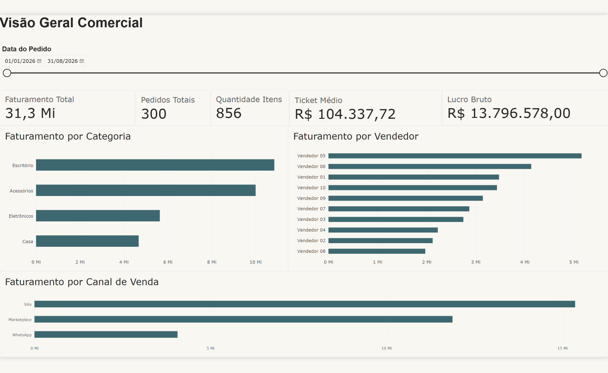
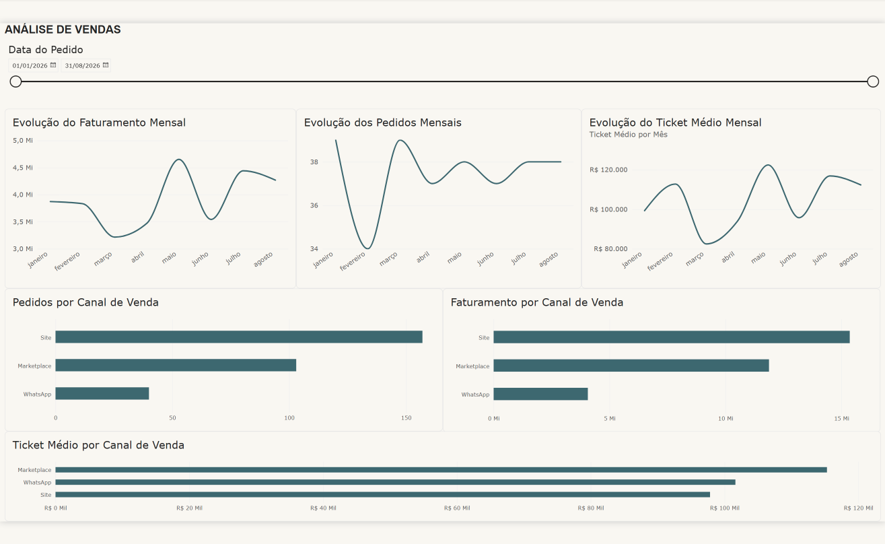

# PrimeCommerce BI

<div align="center">

<h1>PrimeCommerce BI</h1>

<h3>Análise Comercial e Dashboard de Vendas</h3>

<p>Projeto de Business Intelligence desenvolvido por Renato Leone</p>

<p>
<strong>Power BI | Power Query | DAX | Data Analytics | Business Intelligence</strong>
</p>

<p>
Transformando dados comerciais em indicadores, análises e insights para apoiar decisões estratégicas.
</p>

</div>

---

## Visão geral do projeto

O **PrimeCommerce BI** é um projeto de Business Intelligence voltado à análise comercial de um e-commerce fictício de pequeno porte.

O objetivo é transformar dados operacionais em informações gerenciais que permitam compreender o desempenho das vendas, acompanhar indicadores comerciais e identificar oportunidades de melhoria.

O projeto contempla um fluxo de trabalho analítico que envolve perfilamento, avaliação da qualidade, tratamento e transformação dos dados, modelagem, desenvolvimento de indicadores e construção de dashboards interativos no Power BI.

A solução foi estruturada para demonstrar como dados organizados e analisados podem apoiar a compreensão do negócio e contribuir para a tomada de decisões.

## Problema de negócio e objetivos

A gestão da PrimeCommerce precisa acompanhar o desempenho comercial e compreender como o faturamento se distribui entre canais de venda, categorias de produtos, vendedores e clientes.

A análise isolada dessas informações dificulta a identificação de tendências, diferenças de desempenho e oportunidades comerciais.

O projeto busca responder questões como:

- Qual é o faturamento total e como ele evolui ao longo do período?
- Qual é o volume total de pedidos e itens vendidos?
- Como o faturamento se distribui entre categorias de produtos?
- Quais vendedores apresentam maior participação no faturamento?
- Qual canal de venda apresenta maior faturamento?
- Como o ticket médio varia entre os canais?
- Como se comportam os indicadores comerciais ao longo dos meses?
- Qual é o perfil de recorrência dos clientes?
- Existe concentração do faturamento em determinados clientes?
- Como os clientes se distribuem geograficamente?

## Sobre os dados

| Característica | Descrição |
|---|---|
| Fonte | Dados sintéticos desenvolvidos para estudo e portfólio |
| Segmento | E-commerce |
| Período analisado | Janeiro a agosto de 2026 |
| Volume informado | 1.492 pedidos |
| Formato de origem | CSV |
| Plataforma analítica | Microsoft Power BI |

### Tabelas utilizadas

- `clientes`
- `produtos`
- `vendedores`
- `pedidos`
- `itens_pedido`
- `pagamentos`
- `entregas`

Os dados representam uma operação fictícia e não correspondem a uma empresa real.

## Ferramentas e tecnologias

| Tecnologia | Aplicação no projeto |
|---|---|
| Microsoft Power BI Desktop | Desenvolvimento do dashboard e visualização analítica |
| Power Query (M) | Perfilamento, preparação, limpeza e transformação dos dados |
| DAX | Criação de medidas, indicadores e cálculos analíticos |
| Modelagem de dados | Organização das entidades e relacionamentos |
| CSV | Formato dos arquivos de origem |

## Metodologia e etapas do projeto

### 1. Perfilamento e qualidade dos dados

A etapa inicial consistiu na avaliação da estrutura e da consistência dos dados.

Foram verificadas:

- Quantidade de registros por tabela
- Tipos de dados
- Valores nulos
- Valores inválidos
- Espaços extras em campos textuais
- Unicidade das chaves
- Integridade referencial
- Consistência entre tabelas relacionadas

Durante o perfilamento, foram identificadas ocorrências como:

- Valores nulos em campos categóricos e de status
- Quantidade de itens igual a zero
- Preços unitários negativos
- Datas de entrega inconsistentes
- Espaços extras em campos textuais
- Registros sem correspondência em algumas chaves de relacionamento

### 2. Tratamento e preparação dos dados

O tratamento foi realizado no Power Query, considerando as inconsistências identificadas durante o perfilamento.

As ações incluíram:

- Preenchimento controlado de valores nulos com `Não informado`
- Correção de quantidades inválidas
- Correção de preços unitários inválidos com referência ao cadastro de produtos
- Correção de datas de entrega inconsistentes
- Remoção de espaços extras em campos textuais
- Criação de consultas de QA para validação de registros sem correspondência

O processo buscou preservar a consistência das informações e preparar as tabelas para utilização no modelo analítico.

### 3. Modelagem de dados

Foi estruturado um modelo analítico para integrar as principais entidades do e-commerce.

Os relacionamentos contemplam:

- Clientes e pedidos
- Vendedores e pedidos
- Pedidos e itens do pedido
- Produtos e itens do pedido
- Pedidos e pagamentos
- Pedidos e entregas

A modelagem permite analisar os indicadores comerciais a partir de diferentes dimensões do negócio.

### 4. Desenvolvimento de indicadores

Foram desenvolvidas medidas em DAX para acompanhar os principais indicadores comerciais e financeiros.

| Indicador | Objetivo |
|---|---|
| Faturamento Total | Acompanhar o valor total das vendas |
| Pedidos Totais | Monitorar o volume de pedidos |
| Quantidade de Itens | Avaliar o volume de itens comercializados |
| Ticket Médio | Identificar o valor médio por pedido |
| Faturamento Concluído | Acompanhar o faturamento associado aos pedidos concluídos |
| Custo Total | Mensurar o custo dos itens comercializados |
| Lucro Bruto | Avaliar a diferença entre faturamento e custos considerados |

Também foi criada a coluna calculada `Custo_Total`, utilizada para calcular o custo dos itens a partir da quantidade e do custo unitário dos produtos.

Os indicadores devem ser interpretados conforme as regras de negócio e os filtros aplicados no relatório.

## Dashboard Power BI

O dashboard foi desenvolvido em três páginas complementares.

### 01 — Visão Geral Comercial

A página executiva apresenta uma visão consolidada do desempenho comercial.

Principais indicadores e análises:

- Faturamento Total
- Pedidos Totais
- Quantidade de Itens
- Ticket Médio
- Lucro Bruto
- Faturamento por Categoria
- Faturamento por Vendedor
- Faturamento por Canal de Venda



### 02 — Análise de Vendas

A página explora a evolução temporal dos indicadores e permite comparar o desempenho dos canais de venda.

Principais análises:

- Evolução do Faturamento Mensal
- Evolução dos Pedidos Mensais
- Evolução do Ticket Médio Mensal
- Pedidos por Canal de Venda
- Faturamento por Canal de Venda
- Ticket Médio por Canal de Venda



### 03 — Clientes e Canais

A página aprofunda a análise do comportamento dos clientes, da recorrência de compras e da distribuição geográfica.

Principais análises:

- Clientes Únicos
- Clientes Recorrentes
- Faturamento por Cliente
- Pedidos por Cliente
- Faturamento por Estado e Cidade
- Jornada de Recorrência dos Clientes
- Desempenho dos Canais de Venda
- Top 5 Clientes por Faturamento
- Clientes Únicos por Cidade
- Participação dos cinco principais clientes no faturamento


## Principais insights comerciais

As análises realizadas no projeto identificaram os seguintes resultados:

- O **Site** apresenta o maior faturamento e o maior volume de pedidos entre os canais analisados.
- **Escritório** é a categoria com maior faturamento.
- **Março** apresenta o menor faturamento do período.
- Em março, o volume de pedidos permanece elevado, mas o ticket médio é o menor do período, contribuindo para o menor faturamento mensal observado.
- **Maio** apresenta o maior faturamento e o maior ticket médio mensal.
- **Marketplace** apresenta o maior ticket médio entre os canais de venda.

A página Clientes e Canais complementa a análise com informações sobre recorrência, concentração do faturamento e distribuição geográfica.

Os resultados representam o comportamento observado na base sintética utilizada no projeto e não devem ser generalizados para empresas reais.

## Conclusão e recomendações

O PrimeCommerce BI demonstra a aplicação de conceitos de Business Intelligence em um fluxo de trabalho que integra qualidade de dados, preparação, modelagem, desenvolvimento de indicadores e visualização analítica.

A análise permite compreender diferenças de desempenho entre canais, categorias, vendedores e períodos, além de explorar aspectos do comportamento dos clientes.

Com base nos resultados observados, recomenda-se:

- Acompanhar a evolução do faturamento e do ticket médio por canal.
- Investigar oportunidades de melhoria nos períodos de menor faturamento.
- Monitorar a recorrência de compras dos clientes.
- Avaliar a concentração de receita nos principais compradores.
- Comparar o desempenho comercial entre categorias e vendedores.
- Utilizar indicadores integrados para apoiar o planejamento comercial.

As recomendações devem ser avaliadas em conjunto com o contexto operacional e comercial da empresa.

## Estrutura do repositório

```text
PrimeCommerce_BI/
│
├── 01_Dados_Raw/
│   ├── clientes.csv
│   ├── produtos.csv
│   ├── vendedores.csv
│   ├── pedidos.csv
│   ├── itens_pedido.csv
│   ├── pagamentos.csv
│   └── entregas.csv
│
├── 02_Power_BI/
│   └── PrimeCommerce_BI.pbix
│
├── images/
│   ├── dashboard_visao_geral.png
│   ├── dashboard_analise_vendas.png
│   └── dashboard_clientes_canais.png
│
└── README.md
```

## Como reproduzir o projeto

1. Clone ou baixe o repositório.
2. Abra a pasta `02_Power_BI`.
3. Abra o arquivo `PrimeCommerce_BI.pbix` no Power BI Desktop.
4. Verifique os caminhos das fontes de dados, caso necessário.
5. Utilize a opção **Atualizar** para atualizar os dados.
6. Navegue pelas páginas do relatório.

A reprodução poderá exigir ajustes nos caminhos dos arquivos CSV de origem.

## Autor

**Renato Leone**  
Analista de Dados | Business Intelligence

Projeto desenvolvido individualmente para demonstrar competências em análise de dados, qualidade de dados, transformação, modelagem analítica, DAX, Power BI e interpretação de indicadores de negócio.

### Competências demonstradas

- Análise e interpretação de dados
- Data Quality
- Preparação e transformação de dados
- Power Query (M)
- Modelagem de dados
- DAX
- Business Intelligence
- Desenvolvimento de dashboards
- Visualização e comunicação de insights

### Portfólio e contato profissional

- **GitHub:** [github.com/rrleone](https://github.com/rrleone)
- **LinkedIn:** [Perfil profissional](https://www.linkedin.com/)

---

<div align="center">

**RENATO LEONE**

ANALISTA DE DADOS | BI

Dados · Análise · Insights · Decisões

</div>
