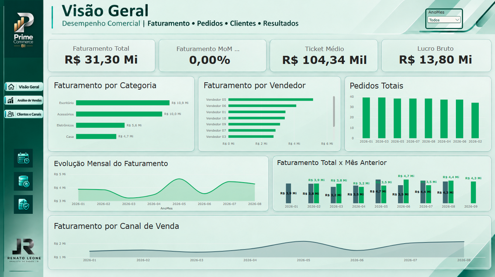
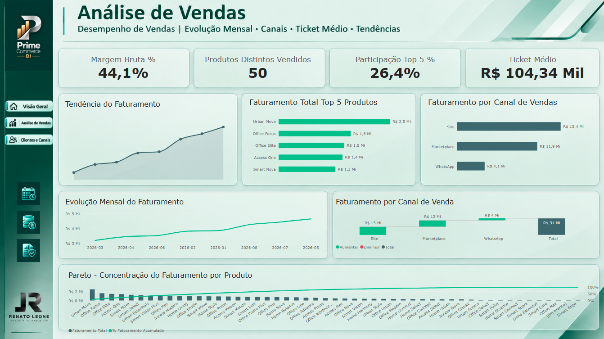
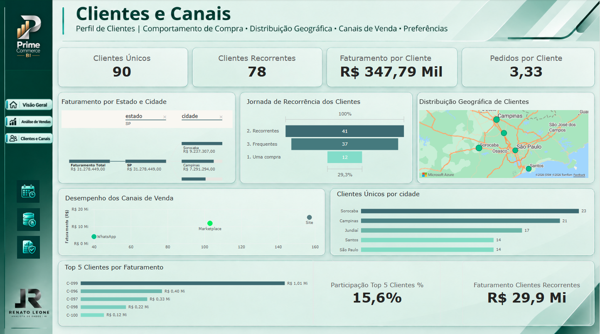

# PrimeCommerce BI

<div align="center">

<h1>PrimeCommerce BI</h1>

<h3>Análise Comercial e Dashboard de Vendas</h3>

<p>Projeto de Business Intelligence desenvolvido por Renato Leone</p>

<p>
  
  
  
  
  
</p>

**Transformando dados comerciais em indicadores, análises e insights para apoiar decisões estratégicas.**

</div>

---

## Visão geral do projeto


O **PrimeCommerce BI** é um projeto de Business Intelligence voltado à análise comercial de um e-commerce fictício de pequeno porte.

O objetivo é transformar dados operacionais em informações gerenciais que permitam compreender o desempenho das vendas, acompanhar indicadores comerciais e identificar oportunidades de melhoria.

O projeto contempla um fluxo analítico que envolve perfilamento, avaliação da qualidade, tratamento e transformação dos dados, modelagem, desenvolvimento de medidas e construção de dashboards interativos no Power BI.

A solução demonstra como dados organizados e analisados podem apoiar a compreensão do negócio e contribuir para decisões comerciais mais fundamentadas.

## Problema de negócio e objetivos

A gestão da PrimeCommerce precisa acompanhar o desempenho comercial e compreender como o faturamento se distribui entre canais de venda, categorias de produtos, vendedores e clientes.

A análise isolada dessas informações limita a compreensão do desempenho global da operação.

**Objetivos do projeto:**

- Acompanhar o faturamento e o volume de pedidos.
- Analisar o desempenho comercial ao longo do tempo.
- Comparar categorias de produtos e canais de venda.
- Avaliar o desempenho dos vendedores.
- Investigar o comportamento dos clientes.
- Identificar oportunidades de melhoria comercial.
- Desenvolver indicadores para apoiar decisões de negócio.

## Dados utilizados

A base utilizada foi desenvolvida para fins de estudo, simulação e portfólio, representando operações de um e-commerce.

**Características da base:**

- **Origem:** dados simulados
- **Segmento:** e-commerce
- **Formato:** arquivos CSV
- **Finalidade:** análise comercial e desenvolvimento de Business Intelligence

### Tabelas utilizadas

| Tabela | Descrição |
|---|---|
| `clientes` | Informações cadastrais dos clientes |
| `produtos` | Cadastro de produtos |
| `vendedores` | Informações dos vendedores |
| `pedidos` | Dados transacionais dos pedidos |
| `itens_pedido` | Produtos e quantidades associados aos pedidos |
| `pagamentos` | Informações de pagamento |
| `entregas` | Dados relacionados às entregas |

## Ferramentas e tecnologias

| Tecnologia | Aplicação |
|---|---|
| Power BI Desktop | Desenvolvimento dos dashboards |
| Power Query (M) | Perfilamento, limpeza e transformação dos dados |
| DAX | Criação de medidas e indicadores |
| Modelagem de dados | Organização das entidades e relacionamentos |
| Business Intelligence | Análise e comunicação dos resultados |

## Etapas do projeto

### 1. Perfilamento e qualidade dos dados

Foi realizada uma avaliação inicial das tabelas para compreender sua estrutura e identificar problemas que poderiam comprometer a análise.

As verificações contemplaram:

- Quantidade de registros.
- Tipos de dados.
- Valores nulos.
- Valores inválidos.
- Espaços extras em campos textuais.
- Unicidade das chaves.
- Integridade referencial entre tabelas.

Durante o perfilamento, foram identificadas ocorrências como valores nulos, quantidades inválidas, preços unitários negativos, datas de entrega inconsistentes e registros sem correspondência entre entidades.

### 2. Tratamento e transformação dos dados

O tratamento foi realizado no Power Query, considerando regras de negócio e validações necessárias para a construção do modelo analítico.

As principais ações incluíram:

- Tratamento controlado de valores nulos.
- Correção de quantidades inválidas.
- Correção de preços unitários inconsistentes.
- Ajustes em datas de entrega.
- Padronização de campos textuais.
- Validação de registros sem correspondência.
- Preparação das tabelas para modelagem.

### 3. Modelagem de dados

Foi estruturado um modelo analítico para integrar as informações comerciais.

Os relacionamentos contemplam:

- Clientes e pedidos.
- Vendedores e pedidos.
- Pedidos e itens.
- Produtos e itens.
- Pedidos e pagamentos.
- Pedidos e entregas.

A modelagem permite relacionar as diferentes entidades e analisar os indicadores sob distintas perspectivas comerciais.

### 4. Indicadores e medidas DAX

Foram desenvolvidas medidas para acompanhar o desempenho da operação.

Entre os principais indicadores:

- Faturamento Total
- Pedidos Totais
- Quantidade de Itens
- Ticket Médio
- Faturamento Concluído
- Custo Total
- Lucro Bruto

Os indicadores foram utilizados para apoiar análises de desempenho, comparação entre períodos e avaliação das dimensões comerciais.

## Dashboards

O relatório foi estruturado em três páginas analíticas.

### 01 — Visão Geral

Apresenta uma visão executiva dos principais indicadores comerciais.



Principais elementos:

- Faturamento Total
- Pedidos Totais
- Quantidade de Itens
- Ticket Médio
- Lucro Bruto
- Faturamento por Categoria
- Faturamento por Vendedor
- Faturamento por Canal de Venda

### 02 — Análise de Vendas

Apresenta a evolução temporal e o desempenho dos canais de venda.



Principais análises:

- Evolução do Faturamento Mensal
- Evolução dos Pedidos Mensais
- Evolução do Ticket Médio Mensal
- Pedidos por Canal de Venda
- Faturamento por Canal de Venda
- Ticket Médio por Canal

### 03 — Clientes e Canais

Apresenta análises relacionadas ao comportamento dos clientes e ao desempenho dos canais comerciais.



A página permite explorar informações relacionadas a clientes, canais de venda e distribuição do desempenho comercial.

## Principais insights

A análise identificou diferenças de desempenho entre canais, categorias e períodos.

Entre os resultados observados:

- O **Site** apresenta o maior faturamento entre os canais de venda.
- O **Site** também apresenta o maior volume de pedidos.
- **Escritório** é a categoria com maior faturamento.
- **Março** apresenta o menor faturamento do período analisado.
- **Maio** apresenta o maior faturamento e o maior ticket médio mensal.
- **Marketplace** apresenta o maior ticket médio entre os canais.

Os resultados representam o comportamento observado na base simulada e devem ser interpretados considerando o contexto e as características dos dados utilizados.

## Conclusão e recomendações

O PrimeCommerce BI demonstra a aplicação de conceitos de Business Intelligence em um fluxo analítico que contempla perfilamento, qualidade e tratamento dos dados, modelagem, criação de indicadores e desenvolvimento de dashboards.

O projeto evidencia como a integração de dados comerciais pode ampliar a compreensão do desempenho do negócio.

Como oportunidades de análise e acompanhamento, recomenda-se:

- Monitorar a evolução do faturamento e do ticket médio.
- Avaliar o desempenho dos canais de venda.
- Investigar períodos de menor faturamento.
- Acompanhar o desempenho das categorias de produtos.
- Utilizar indicadores comerciais para apoiar o planejamento e a tomada de decisões.

## Estrutura do repositório

```text
PrimeCommerce_BI/
│
├── 01_Dados_Raw/
│   ├── clientes.csv
│   ├── produtos.csv
│   ├── vendedores.csv
│   ├── pedidos.csv
│   ├── itens_pedido.csv
│   ├── pagamentos.csv
│   └── entregas.csv
│
├── 02_Power_BI/
│   └── PrimeCommerce_BI.pbix
│
├── 03_Images/
│   ├── Capa_PrimeCommerce BI.png
│   ├── dashboard_visao_geral.png
│   ├── dashboard_analise_vendas.png
│   └── dashboard_clientes_canais.png
│
└── README.md
```

## Como reproduzir o projeto

1. Clone ou baixe o repositório.
2. Acesse a pasta `02_Power_BI`.
3. Abra `PrimeCommerce_BI.pbix` no Power BI Desktop.
4. Verifique os caminhos das fontes de dados, caso necessário.
5. Atualize os dados utilizando a opção **Atualizar**.
6. Navegue pelas páginas do relatório.

Os dados utilizados são simulados e destinados a fins de estudo, demonstração técnica e portfólio. A reprodução poderá exigir ajustes nos caminhos dos arquivos de origem.

## Autor

**Renato Leone**  
Analista de Dados | Business Intelligence

Projeto desenvolvido individualmente para demonstrar competências em análise de dados, qualidade de dados, Power Query, modelagem analítica, DAX e desenvolvimento de dashboards no Power BI.

### Competências demonstradas

- Análise e interpretação de dados
- Data Quality
- Power Query (M)
- Modelagem de dados
- DAX e indicadores de negócio
- Business Intelligence
- Visualização e comunicação de insights

### Portfólio e contato profissional

- **GitHub:** [github.com/rrleone](https://github.com/rrleone)
- **Repositório:** [PrimeCommerce_BI](https://github.com/rrleone/PrimeCommerce_BI)
- **Portfólio:** [Renato Leone — Data Analytics & BI](https://sites.google.com/view/renatoleone/)

---

<div align="center">

**PRIMECOMMERCE BI**

Dados · Análise · Insights · Decisões

**RENATO LEONE | DATA ANALYTICS & BUSINESS INTELLIGENCE**

</div>
